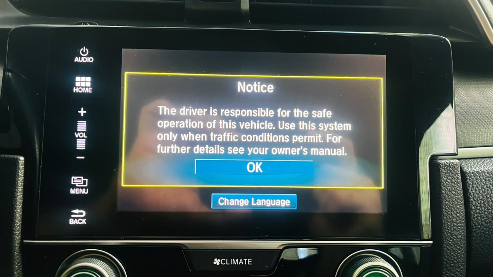

<div align="center">


# Honda Civic G10 — Skip Disclaimer

**Automatically dismiss the "Warning" disclaimer screen that appears every time you turn on your Honda Civic**

[](LICENSE)
[](docs/en/fase10-deploy-2026-10-29/README.md)
[]()
[]()
[](docs/en/fase10-deploy-2026-10-29/README.md)
[]()
[](https://github.com/khalleb/honda-civic-headunit/actions/workflows/ci.yml)

[🇧🇷 Português](README.md) · 🇺🇸 **English**

</div>

---

## 🎬 Before and after

<div align="center">


**Every time you turn the car on, the head unit showed the Warning.** Before, you had to tap it manually. Today **the warning does not appear at all** — the boot flow jumps straight to the launcher (Phase 10, deployed 2026-10-29).

</div>

---

## 🎯 The problem

<div align="center">


<sub>Real photo from the Brazilian 2017 Civic EXL with the head unit switched to English. The dialog layout, OK button position and the auto-dismiss behavior are the same in every supported locale — only the text changes.</sub>
</div>

Every time you turn the car on, the head unit shows:

> **"Notice — The driver is responsible for the safe operation of this vehicle. Use this system only when traffic conditions permit. For further details see your owner's manual."**

And you have to tap **OK**. Every. Single. Time. Before CarPlay starts. Every ignition cycle, 365 days a year, for years.

Honda has **never** released a configuration to disable this.

## ✨ The solution — in two layers

Everything is delivered via **EvilValet** (discovered by [juniperspring.org](https://juniperspring.org/posts/honda-evil-valet/)) — a "fake" OTA package signed with the public AOSP testkey, which the head unit's `daupdater` accepts as if it were an official update.

### Layer 1 — AutoOk (automatic safety net)

APK + `su` setuid installed into `/system/`. The APK monitors logcat, detects the warning Activity, and fires a simulated `input tap` at (400, 350). Warning used to appear for ~3 s and vanish on its own. Kept as a fallback: if the Layer 2 patch ever fails, this still dismisses the warning.

### Layer 2 — Phase 10 (smali patch in DaLauncher — the definitive fix)

A **one-instruction bytecode patch** in `DaLauncher.apk` (`OpeningDivideActivity.smali:671`): `if-nez v0, :cond_9` → `goto :cond_9`. Forces the boot flow to skip the `DisclaimerFragment` and go straight to the branch that already loaded CarPlay, navigation and everything else. **The warning simply no longer exists in the flow**, forever.

A second patch (Phase 10.1) reduces an intermediate ecoscore screen from ~6 s to ~1 s.

**Observed in the car (2026-10-29):** warning removed, CarPlay projects, navigation works, backup camera works, zero crashes. Details in [`docs/en/fase10-deploy-2026-10-29/README.md`](docs/en/fase10-deploy-2026-10-29/README.md).

**Safety net preserved:** AutoOk (Layer 1) stays in `/system/app/` as an automatic fallback for the first week. Can be removed afterwards via `tooling/ota-build/output-rollback/` without affecting the patch.

### 📹 Proof: real deploy in the owner's car

<div align="center">


<sub>Real footage from the Brazilian 2017 Civic EXL (firmware `1.F187.16`), recorded before Phase 10 was deployed. The warning in the video is in Portuguese because that's the owner's car. International variants show the same flow with the warning translated to your local language. After Phase 10 (2026-10-29) the warning does not appear at all.</sub>
</div>

---

## 🏗️ How it works (60 second view)

<div align="center">

</div>

**On the PC** (one time, ~15 min):
1. Compile the AutoOk APK (`gradlew assembleRelease`) **or** rebuild the patched `DaLauncher.apk` (`bash tooling/fase10/rebuild-dalauncher.sh`)
2. Sign with AOSP testkey (`apksigner`)
3. Build OTA package signed with AOSP testkey (`python3 build.py` for AutoOk; `python3 build-dalauncher-fase10.py` for Phase 10)
4. Write to a FAT32 USB stick (`prepare-pendrive-install.sh`)

**In the car** (one time per deploy, ~10 min):
1. USB stick into the front USB-A port
2. Hold `AUDIO` button for 5s → confirm "Reboot?"
3. Head unit reboots, recovery applies the package
4. APK lands in `/system/` — permanent

**In operation** (automatic, forever):
- With Layer 1 only (AutoOk): on every boot, the APK dismisses the warning in ~3 s
- With Layer 2 (Phase 10): the warning **never appears at all**
- Zero maintenance. Zero interaction.

---

## 🚗 Compatibility

### ✅ Confirmed working

| Car | DA Version | Market | Rom type | Status |
|---|---|---|---|---|
| Honda Civic 2017 EXL | `1.F187.16` | 🇧🇷 Brazil | `0040` | ✅ AutoOk deployed 2026-10-16 · Phase 10 deployed 2026-10-29 |

### 🤷 Likely compatible (not tested)

Same Mitsubishi Andromeda framework — likely works with adaptation of 2 values:
- **Civic G10 2016-2021** (US, EU, AU, other BR variants)
- **Civic Avancier, Civic URV**
- **CR-V 2016-2021** (some firmware)
- **Accord 2016+** with Display Audio

If you have a different firmware, [help the community](#-contributing) — just 2 pieces of info confirm it works: your `custom_rom.type` and screen resolution.

👉 How to adapt for other firmware: [`docs/en/03-finding-your-firmware.md`](docs/en/03-finding-your-firmware.md)

---

## 🚀 Quick Start

**Own a 2017 Civic EXL BR?** Deploy in ~20 minutes:

👉 **[QUICKSTART.md](QUICKSTART.md)** (currently Portuguese — commands are universal)

Summary:
```bash
git clone https://github.com/khalleb/honda-civic-headunit.git
cd honda-civic-headunit
./MIGRATION/setup.sh                     # clone dependencies
cd our-apk && ./gradlew assembleRelease  # build APK
# ... sign + copy to overlay ...
python3 tooling/ota-build/build.py       # OTA package
sudo ./tooling/scripts/prepare-pendrive-install.sh /dev/sda
# In the car: AUDIO 5s + confirm reboot
```

**Different firmware?** First adapt following [`docs/en/03-finding-your-firmware.md`](docs/en/03-finding-your-firmware.md).

---

## ⚠️ Important warnings

- 🧱 **Can cause permanent brick** of the head unit if done wrong. Replacement costs R$ 1,000-2,000 (~USD 200-400).
- 📷 **The screen is also the backup camera** — brick = no backup camera until replacement.
- 🔄 **Official Honda OTAs may revert** the modification. You'll need to redeploy.
- ✅ **CarPlay, Bluetooth, audio, navigation keep working** — our modification is surgical.
- 🔒 **No backdoor for Honda to detect.** APK sits in /system/app like any system app.

**Read the full [DISCLAIMER.md](DISCLAIMER.md) before executing anything.**

---

## 🔬 What we discovered along the way

Beyond the APK that dismisses the warning, we mapped a lot of the Mitsubishi Andromeda platform. Useful if you want to adapt the project for another firmware, build other apps on the same HU, or understand the real power flow of the unit (LP0, backup camera, HMI service start).

Summary with links to the dense docs: [`DISCOVERIES.md`](DISCOVERIES.md).

Some highlights:

- **16 PowerManager broadcasts** mapped, with known causes (`ColdBoot`, `ExitLP0`, `AccOnRestart`). 33 shipping APKs listen for `ACTION_HMI_SERVICE_START` — this is the official recovery contract after LP0, not a workaround.
- **364 AIDL interfaces** in 63 domains. `appservice.vehicleinfomanager` alone has 37 listeners covering gear, speed, VIN, current FOB key, steering angle.
- **445 vendor broadcasts** across 48 prefixes (navi, HFT, camera, launcher, PowerManager, diag).
- **27 ContentProvider authorities** (9 vendor, including the real flow of the Mitsubishi whitelist — which, surprise, is UX-only and does not affect LP0).
- **Hall of fame of 14 bugs** fixed with documented root causes — useful for other Mitsubishi RE projects.

## 🧰 Reusable tooling

Infrastructure that lives alongside the project and works for other HUs with the same stack:

- [`tooling/deodex/deodex-apk.sh`](tooling/deodex/deodex-apk.sh) — automates odex → APK for any Mitsubishi APK (all vendor-app is pre-dexed). Validated on 160 APKs from the dump.
- EvilValet OTA package with embedded `busybox` ARM — ours needs it because the BR recovery lacks `/sbin/sh`. Works for other firmwares on the same recovery.
- Deep-scan OTA package — dumps `/system`, `/data/system/packages.xml`, partition tree + `/proc/*` in a single pass. Feeds the unit atlas.
- [REA](https://github.com/morluto/rea) + MCP flow already configured in [`tooling/deodex/`](tooling/deodex/) — static analysis of any Android APK through the agent.

## 🗺️ Where this is heading

Original goal achieved on 2026-10-29. Everything below is exploratory; details in [`ROADMAP.md`](ROADMAP.md).

- **Phase 9 — backup camera via official API.** Replace the current logcat polling with a bind on `ICameraAPServiceReverseSignalListener`, with `ACTION_RESUME_CAMERA` as fallback. TX codes for `IVehicleInfoManagerApService` are already mapped (via `alexpotv/Clusters`), including the `MICU_BCM`/`MICU_ICU` signal that carries the reverse light.
- Dump the real `com.honda.displayaudio.whitelist.apk` to confirm the XML format (today it's inferred from the parser).
- Try `persist.sys.keyoff_reboot=1` — theoretically forces a cold boot on every keyoff and eliminates the whole LP0 complexity.
- Swap `/system/xbin/su` for the official SuperSU — the current one turned out to be KingoSU (finding from the GitHub landscape scan on 2026-10-27).

---

## 📚 Documentation

### 🇺🇸 In English

| Doc | Description |
|---|---|
| [`QUICKSTART.md`](QUICKSTART.md) | Deploy in 20 min (Portuguese — commands universal) |
| [`docs/en/00-overview.md`](docs/en/00-overview.md) | What the project does and why |
| [`docs/en/01-attack-architecture.md`](docs/en/01-attack-architecture.md) | How the EvilValet attack works |
| [`docs/en/02-prerequisites.md`](docs/en/02-prerequisites.md) | Hardware, software, keystore |
| [`docs/en/03-finding-your-firmware.md`](docs/en/03-finding-your-firmware.md) | Adapt for other firmware |
| [`docs/en/04-building-the-package.md`](docs/en/04-building-the-package.md) | Build the OTA package step by step |
| [`docs/en/05-deploying-in-car.md`](docs/en/05-deploying-in-car.md) | Deploy protocol in the car |
| [`docs/en/06-troubleshooting.md`](docs/en/06-troubleshooting.md) | Decision tree when something fails |
| [`docs/en/07-rollback.md`](docs/en/07-rollback.md) | Revert everything |
| [`docs/en/08-backups.md`](docs/en/08-backups.md) | Full backup catalog |
| [`docs/en/09-fase10-remove-warning.md`](docs/en/09-fase10-remove-warning.md) | 🎯 Phase 10 — remove the warning for good via DaLauncher patch |

### 🇧🇷 In Portuguese (original)

Same docs under [`docs/pt-BR/`](docs/pt-BR/). The deep technical dive and the deploy narrative in [`docs/fase7-deploy-2026-10-16/`](docs/fase7-deploy-2026-10-16/) are still Portuguese-only — PRs welcome.

### 🔬 Deep technical dive

- [`DISCOVERIES.md`](DISCOVERIES.md) — Navigable index of technical findings (Portuguese, link labels mostly English)
- [`ROADMAP.md`](ROADMAP.md) — Next steps, discarded routes with reason
- [`docs/MAPA.md`](docs/MAPA.md) — **Navigable atlas of the HU** (partitions, APKs, services, pipeline) — mostly Portuguese labels but structure is clear
- [`docs/fase7-deploy-2026-10-16/`](docs/fase7-deploy-2026-10-16/) — Layer 1 (AutoOk): journey, discoveries, recipes, dumps, APK architecture, maintenance (Portuguese)
- [`docs/en/fase10-deploy-2026-10-29/`](docs/en/fase10-deploy-2026-10-29/) — **Layer 2 (smali patch)**: deploy timeline, Phase 10.1, car logs
- [`docs/raio-x/`](docs/raio-x/) — Static platform scan: 364 AIDLs, 445 broadcasts, 27 providers, 48 sysprops, trust map of 110 APKs + RE Layer 2 of the services (steering wheel, official OTA, vehicle, audio) + landscape scan of 33 adjacent GitHub projects
- [`docs/whitelist-mitsubishi-2026-10-19.md`](docs/whitelist-mitsubishi-2026-10-19.md) — Full Mitsubishi whitelist flow + mapping of recovery after LP0

---

## 🙏 Credits

This project wouldn't exist without:

- **[librick / Eric McDonald](https://juniperspring.org/)** — discovery and technical documentation of the **EvilValet** vulnerability, `ota-builder`, `apk-rebuilder` ([ic1101](https://github.com/librick/ic1101))
- **[@codeage](https://github.com/codeage/root-honda)** — root tool with static ARM `su`, SuperSU, Mitsubishi whitelist analysis
- **[@jersacct](https://github.com/jersacct/2016PilotOneClick)** — mother project for Honda rooting via DirtyCOW

**Our contribution** is the adaptation to the Brazilian firmware `1.F187.16` (rom type `0040`, `AUDIO 5s` combo for cold boot, discovery that BR recovery doesn't ship `/sbin/sh` and needs embedded busybox, persistent APK that re-arms after each tap, deep-scan pipeline to sync the HU atlas) **and Phase 10** (discovery of the `OpeningDivideActivity.sDisclamerFlg` gate as a static boolean in memory, two one-instruction smali patches, self-contained rebuild pipeline with `orig → patch` bytecode proof).

Technical details: [`docs/fase7-deploy-2026-10-16/02-descobertas-tecnicas.md § 0`](docs/fase7-deploy-2026-10-16/02-descobertas-tecnicas.md#0-contribuições-novas-deste-projeto) (Portuguese).

---

## 🤝 Contributing

We welcome:

1. **Have another Honda G10 firmware?** Open an issue using the [`nova-safra.md`](.github/ISSUE_TEMPLATE/nova-safra.md) template. Include VIN prefix, DA version, `custom_rom.type`, screen resolution. We'll build a compatibility matrix.
2. **Found a bug or improvement?** Issues + PRs welcome.
3. **Want to translate to another language?** Fork + PR with new `docs/<lang>/` folder. **Priority: complete the English translation of docs 01, 02, 04, 05, 06.**
4. **Tested on another car and it worked?** Report via issue — becomes a row in the compatibility table.

See [`CONTRIBUTING.md`](CONTRIBUTING.md) for details.

---

## 📄 License

Code: [MIT](LICENSE). Documentation: CC BY 4.0.

Honda/Mitsubishi proprietary software referenced is owned by respective holders. **This repo does NOT distribute proprietary firmware** — you must dump from your own HU (see [`docs/en/03-finding-your-firmware.md`](docs/en/03-finding-your-firmware.md)).

---

<div align="center">

**Made by the Honda Civic G10 community, for the Honda Civic G10 community.**

[🇧🇷 Português](README.md) · 🇺🇸 **English**

</div>
