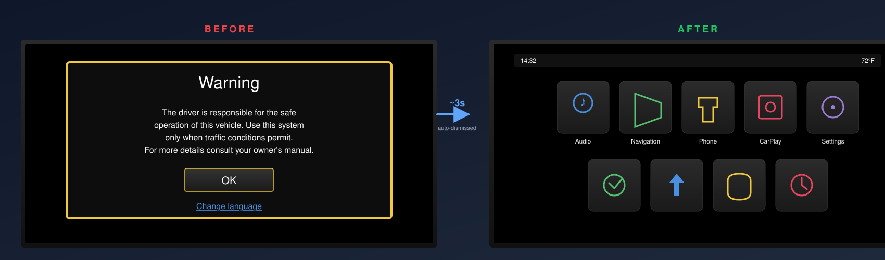
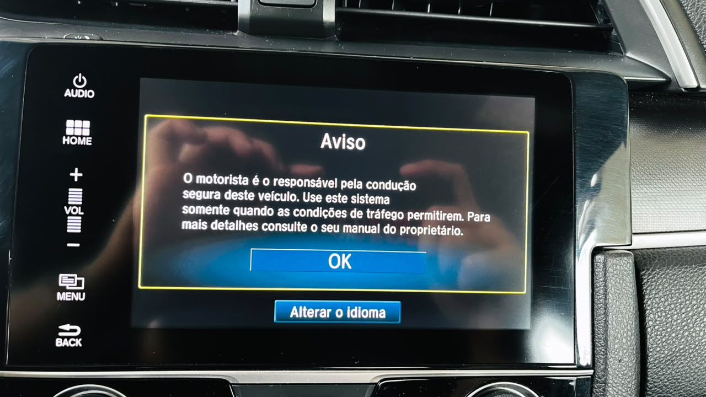
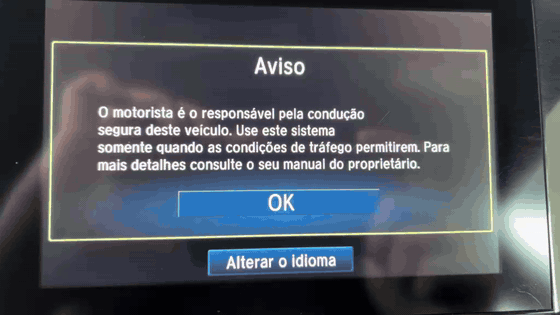
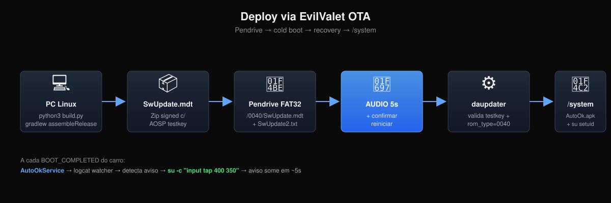

<div align="center">


# Honda Civic G10 — Skip Disclaimer

**Automatically dismiss the "Warning" disclaimer screen that appears every time you turn on your Honda Civic**

[](LICENSE)
[]()
[]()
[]()
[]()

[🇧🇷 Português](README.md) · 🇺🇸 **English**

</div>

---

## 🎬 Before and after

<div align="center">



**Every time you turn the car on, the head unit shows the Warning.** Before, you had to tap it manually. Now the warning appears and disappears on its own in ~3 seconds — you don't even touch the screen.

</div>

---

## 🎯 The problem

<div align="center">


<sub>Real photo from the owner's 2017 Civic EXL BR. The international variants show the same screen in English/your local language — the only difference is the translated text; the layout, button position and behavior are identical.</sub>
</div>

Every time you turn the car on, the head unit shows:

> **"Warning — The driver is responsible for safe driving..."**

And you have to tap **OK**. Every. Single. Time. Before CarPlay starts. Every ignition cycle, 365 days a year, for years.

Honda has **never** released a configuration to disable this.

## ✨ The solution

We install an APK + `su` setuid binary into `/system/` of the head unit via the **EvilValet** vulnerability (discovered by [juniperspring.org](https://juniperspring.org/posts/honda-evil-valet/)) — a "fake" OTA package signed with the public AOSP testkey.

Once installed, the APK:

1. **Monitors logcat** looking for the warning Activity to appear
2. **Waits ~2 seconds** (lets the UI render fully)
3. **Fires a simulated tap** via `su -c "input tap 400 350"` on the OK button coordinates
4. **Warning disappears**. You barely noticed.

Zero human touch. Works on every car start, forever.

### 📹 Proof: real deploy in the owner's car

<div align="center">


<sub>Real footage from the Brazilian 2017 Civic EXL (firmware `1.F187.16`). The warning in the video is in Portuguese because that's the owner's car. International variants show the same flow with the warning translated to your local language.</sub>
</div>

---

## 🏗️ How it works (60 second view)

<div align="center">

</div>

**On the PC** (one time, ~15 min):
1. Compile the APK (`gradlew assembleRelease`)
2. Sign with debug keystore (`apksigner`)
3. Build OTA package signed with AOSP testkey (`python3 build.py`)
4. Write to a FAT32 USB stick (`prepare-pendrive-install.sh`)

**In the car** (one time, ~10 min):
1. USB stick into the front USB-A port
2. Hold `AUDIO` button for 5s → confirm "Reboot?"
3. Head unit reboots, recovery applies the package
4. APK + `su` land in `/system/` — permanent

**In operation** (automatic, forever):
- On every car boot, the APK sees the warning appear and dismisses it in ~3s
- Zero maintenance. Zero interaction.

---

## 🚗 Compatibility

### ✅ Confirmed working

| Car | DA Version | Market | Rom type | Status |
|---|---|---|---|---|
| Honda Civic 2017 EXL | `1.F187.16` | 🇧🇷 Brazil | `0040` | ✅ Deployed 2026-10-16 |

### 🤷 Likely compatible (not tested)

Same Mitsubishi Andromeda framework — likely works with adaptation of 2 values:
- **Civic G10 2016-2021** (US, EU, AU, other BR variants)
- **Civic Avancier, Civic URV**
- **CR-V 2016-2021** (some firmware)
- **Accord 2016+** with Display Audio

If you have a different firmware, [help the community](#-contributing) — just 2 pieces of info confirm it works: your `custom_rom.type` and screen resolution.

👉 How to adapt for other firmware: [`docs/en/03-finding-your-firmware.md`](docs/en/03-finding-your-firmware.md)

---

## 🚀 Quick Start

**Own a 2017 Civic EXL BR?** Deploy in ~20 minutes:

👉 **[QUICKSTART.md](QUICKSTART.md)** (currently Portuguese — commands are universal)

Summary:
```bash
git clone https://github.com/khalleb/honda-civic-headunit.git
cd honda-civic-headunit
./MIGRATION/setup.sh                     # clone dependencies
cd our-apk && ./gradlew assembleRelease  # build APK
# ... sign + copy to overlay ...
python3 tooling/ota-build/build.py       # OTA package
sudo ./tooling/scripts/prepare-pendrive-install.sh /dev/sda
# In the car: AUDIO 5s + confirm reboot
```

**Different firmware?** First adapt following [`docs/en/03-finding-your-firmware.md`](docs/en/03-finding-your-firmware.md).

---

## ⚠️ Important warnings

- 🧱 **Can cause permanent brick** of the head unit if done wrong. Replacement costs R$ 1,000-2,000 (~USD 200-400).
- 📷 **The screen is also the backup camera** — brick = no backup camera until replacement.
- 🔄 **Official Honda OTAs may revert** the modification. You'll need to redeploy.
- ✅ **CarPlay, Bluetooth, audio, navigation keep working** — our modification is surgical.
- 🔒 **No backdoor for Honda to detect.** APK sits in /system/app like any system app.

**Read the full [DISCLAIMER.md](DISCLAIMER.md) before executing anything.**

---

## 📚 Documentation

### 🇺🇸 In English

| Doc | Description |
|---|---|
| [`docs/en/00-overview.md`](docs/en/00-overview.md) | What the project does and why |
| [`docs/en/03-finding-your-firmware.md`](docs/en/03-finding-your-firmware.md) | Adapt for other firmware |
| [`docs/en/07-rollback.md`](docs/en/07-rollback.md) | Revert everything |
| [`docs/en/08-backups.md`](docs/en/08-backups.md) | Full backup catalog |

### 🇧🇷 In Portuguese (full documentation)

| Doc | Description |
|---|---|
| [`QUICKSTART.md`](QUICKSTART.md) | Deploy in 20 min |
| [`docs/pt-BR/01-arquitetura-ataque.md`](docs/pt-BR/01-arquitetura-ataque.md) | How EvilValet works |
| [`docs/pt-BR/02-pre-requisitos.md`](docs/pt-BR/02-pre-requisitos.md) | Hardware, software, keystore |
| [`docs/pt-BR/04-build-do-pacote.md`](docs/pt-BR/04-build-do-pacote.md) | Build the OTA package |
| [`docs/pt-BR/05-deploy-no-carro.md`](docs/pt-BR/05-deploy-no-carro.md) | Deploy protocol in the car |
| [`docs/pt-BR/06-troubleshooting.md`](docs/pt-BR/06-troubleshooting.md) | Troubleshooting when something fails |

Translations of these to English welcome! See [Contributing](#-contributing).

### 🔬 Deep technical dive

- [`docs/MAPA.md`](docs/MAPA.md) — **Navigable atlas of the HU** (partitions, APKs, services, pipeline) — mostly Portuguese labels but structure is clear
- [`docs/fase7-deploy-2026-10-16/`](docs/fase7-deploy-2026-10-16/) — 7 docs with journey, discoveries, recipes, dumps, APK architecture, maintenance (Portuguese)

---

## 🙏 Credits

This project wouldn't exist without:

- **[librick / Eric McDonald](https://juniperspring.org/)** — discovery and technical documentation of the **EvilValet** vulnerability, `ota-builder`, `apk-rebuilder` ([ic1101](https://github.com/librick/ic1101))
- **[@codeage](https://github.com/codeage/root-honda)** — root tool with static ARM `su`, SuperSU, Mitsubishi whitelist analysis
- **[@jersacct](https://github.com/jersacct/2016PilotOneClick)** — mother project for Honda rooting via DirtyCOW

**Our contribution** is the adaptation to the Brazilian firmware `1.F187.16` (rom type `0040`, `AUDIO 5s` combo for cold boot, discovery that BR recovery doesn't ship `/sbin/sh` and needs embedded busybox, persistent APK that re-arms after each tap, deep-scan pipeline to sync the HU atlas).

Technical details: [`docs/fase7-deploy-2026-10-16/02-descobertas-tecnicas.md § 0`](docs/fase7-deploy-2026-10-16/02-descobertas-tecnicas.md#0-contribuições-novas-deste-projeto) (Portuguese).

---

## 🤝 Contributing

We welcome:

1. **Have another Honda G10 firmware?** Open an issue using the [`nova-safra.md`](.github/ISSUE_TEMPLATE/nova-safra.md) template. Include VIN prefix, DA version, `custom_rom.type`, screen resolution. We'll build a compatibility matrix.
2. **Found a bug or improvement?** Issues + PRs welcome.
3. **Want to translate to another language?** Fork + PR with new `docs/<lang>/` folder. **Priority: complete the English translation of docs 01, 02, 04, 05, 06.**
4. **Tested on another car and it worked?** Report via issue — becomes a row in the compatibility table.

See [`CONTRIBUTING.md`](CONTRIBUTING.md) for details.

---

## 📄 License

Code: [MIT](LICENSE). Documentation: CC BY 4.0.

Honda/Mitsubishi proprietary software referenced is owned by respective holders. **This repo does NOT distribute proprietary firmware** — you must dump from your own HU (see [`docs/en/03-finding-your-firmware.md`](docs/en/03-finding-your-firmware.md)).

---

<div align="center">

**Made by the Honda Civic G10 community, for the Honda Civic G10 community.**

[🇧🇷 Português](README.md) · 🇺🇸 **English**

</div>
