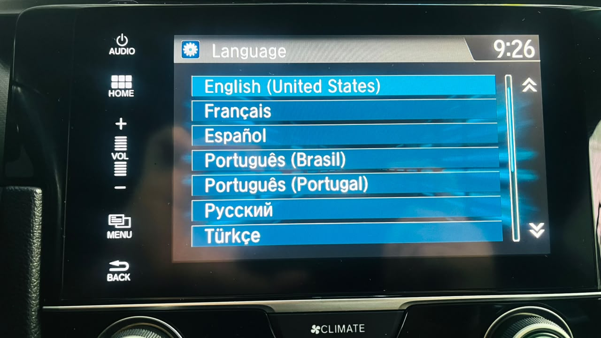
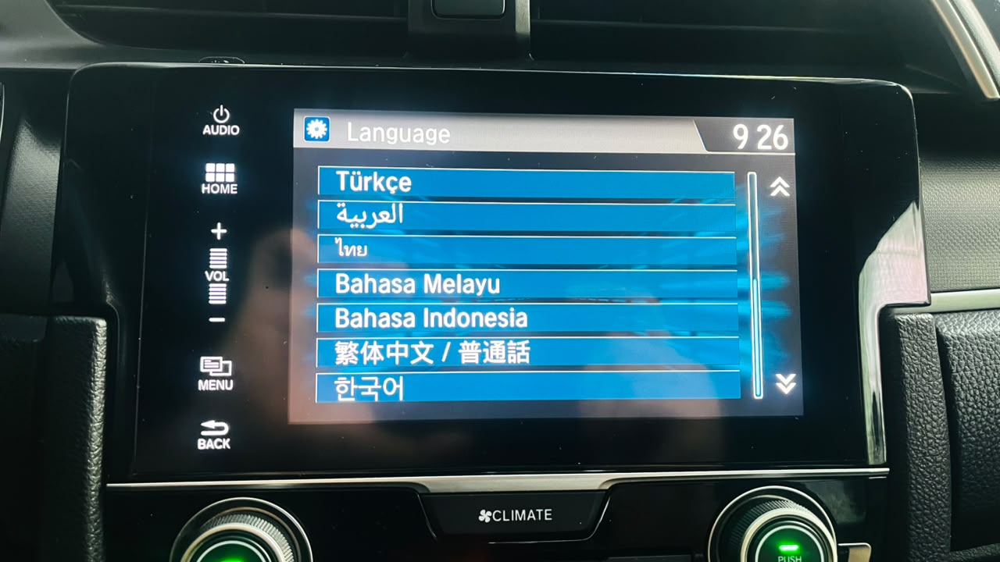

# 00 — Overview

## The problem

Every time you turn on your Honda Civic G10 (Brazilian or international firmware), the head unit shows this screen:

<div align="center">

</div>

The literal text from the Honda firmware (English locale):

> **Notice** — The driver is responsible for the safe operation of this vehicle. Use this system only when traffic conditions permit. For further details see your owner's manual. **[OK]**

You have to tap OK before using CarPlay, radio, or anything else. Small pain. Daily. Multiplied by years of ownership = considerable annoyance.

Honda has **never** released a configuration to disable this screen — they treat it as legal liability.

### Multi-locale support confirmed

The head unit supports 14 locales out of the box. The dialog layout, OK button position and our APK's auto-dismiss behavior are identical in every one — only the translated text changes. Primary and secondary language lists:

<div align="center">


</div>

The implication for anyone adapting this project: `OpeningDivideActivity` is the only intent target to watch, and tap coordinates `(400, 350)` on a 800×480 screen hit the OK button regardless of locale.

## Existing options before this project

| Option | Cost | Problems |
|---|---|---|
| Honda Hack (`cn.autohack.hondahack`) | USD 25 | Closed source, obfuscated with Tencent StubShell, perpetual payment, author may disappear |
| Modify the launcher | — | High brick risk, requires existing root, very complex |
| Nothing | — | Tap OK every single day |

## What we did — in two layers

Everything is delivered via **EvilValet** (vulnerability discovered and documented by librick / Eric McDonald): OTA packages signed with the public AOSP testkey, which the car's `daupdater` accepts as if it were an official Honda firmware update.

### Layer 1 — AutoOk (automatic safety net, Phase 7, 2026-10-16)

Our own APK deployed to `/system/app/AutoOk.apk` + `su` setuid in `/system/xbin/`. The APK monitors logcat, detects the Warning Activity being started and fires `su -c "input tap 400 350"` — simulates an invisible tap on the OK button. **Result:** warning appeared and disappeared on its own in ~3 s, zero manual interaction.

### Layer 2 — Phase 10 (smali patch in DaLauncher, 2026-10-29)

A **one-instruction bytecode patch** in `DaLauncher.apk` (`OpeningDivideActivity.smali:671`): `if-nez v0, :cond_9` → `goto :cond_9`. Forces the boot flow to skip the `DisclaimerFragment` (the Warning screen) and land directly on the branch that already loaded CarPlay, navigation and everything else. **The warning simply no longer exists in the flow**, forever.

A second patch (Phase 10.1, same day) swaps `const/16 v1, 0x1388` for `const/16 v1, 0x1f4` in `EcoFragment.startNoOperationTimer` — reduces an intermediate ecoscore screen from ~6 s to ~1 s while keeping all 4 calls CarPlay/Navigation expect (`DISCLAIMER_COMPLETE`, `setDisplayPermission`, `disclaimerDisappeared`, `setDisclaimerPassed`).

**Observed in the car on 2026-10-29:** warning completely removed, CarPlay projects, navigation works, backup camera works, zero crashes. Step-by-step guide to reapply: [`09-fase10-remove-warning.md`](09-fase10-remove-warning.md). Full timeline of the real deploy: [`../fase10-deploy-2026-10-29/README.md`](../fase10-deploy-2026-10-29/README.md) (Portuguese).

## Result

| With | Visual experience | Prerequisite |
|---|---|---|
| **Layer 1 only (AutoOk)** | Warning appears and disappears on its own in ~3 s | AutoOk OTA package |
| **Layers 1 + 2 (recommended)** | **Warning never appears.** Ecoscore screen for ~1 s instead | AutoOk OTA package + Phase 10 package |

CarPlay, Bluetooth, audio, navigation, backup camera **keep working** in both routes. Rollback available anytime via the matching OTA packages.

## Who this is for

- **You:** owner of Brazilian Civic G10 (`1.F187.16`, EXL or similar). Tested and working.
- **Possibly others:** G10 2016-2021 US/EU/AU, Civic Avancier/URV, CR-V 2016-2021, Accord 2016+. **Not tested** — you'll need to adapt coords and rom_type. See [`03-finding-your-firmware.md`](03-finding-your-firmware.md).

## High-level flow

```
FAT32 pendrive with SwUpdate.mdt signed by testkey
      │
      ▼ (front USB-A port + AUDIO 5s + confirm reboot)
Head unit does cold boot
      │
      ▼
SystemUpdate.apk accepts the update (signature verifies)
      │
      ▼
daupdater validates rom_type (0040 for our firmware) + reboots into recovery
      │
      ▼
Recovery validates testkey signature + applies updater-script
      │
      ▼ (via embedded busybox + edify mount)
Installs /system/app/AutoOk.apk + /system/xbin/su
      │
      ▼
Normal boot. AutoOkService starts on BOOT_COMPLETED.
      │
      ▼ (every time the warning appears)
Logcat watcher detects Activity → su -c input tap 400 350 → warning disappears
```

Detailed diagram: [`../images/arquitetura.svg`](../images/arquitetura.svg).

## Why this approach is safer than alternatives

| Approach | Brick risk | Reversible? | Detectable by Honda? |
|---|---|---|---|
| **Ours (EvilValet + APK in /system/app)** | Low — we only add 2 new files, nothing modified | Yes — rollback OTA removes everything | No — APK sits in /system/app like any system app |
| Modify `DaLauncher.apk` | High — launcher brick = black screen | Yes but requires OTA | No |
| Xposed Framework | High — patches `/system/bin/app_process`, bootloop on failure | Yes but delicate | Possibly (fingerprint changes) |
| Honda Hack (paid) | Low | Yes | Possible (checksum) |

Our attack is **surgical**: we don't touch anything already in `/system`. If something goes wrong, remove the 2 new files and the HU returns to factory state.

## Original technical documentation

The final deploy session is in [`docs/fase7-deploy-2026-10-16/`](../fase7-deploy-2026-10-16/) — 7 docs with full narrative, detailed technical discoveries, build recipe, APK architecture, maintenance guide, and dump catalog. **Currently Portuguese** — translation welcome.

The docs in this folder (`docs/en/`) are the **accessible version** for people who want to use/adapt without reading the whole technical journey.

## Next steps

- To deploy on firmware `1.F187.16` BR: → [`QUICKSTART.md`](../../QUICKSTART.md) (Layer 1 — AutoOk; Portuguese, commands are universal)
- For the definitive fix (Layer 2 — Phase 10): → [`09-fase10-remove-warning.md`](09-fase10-remove-warning.md)
- For other firmware: → [`03-finding-your-firmware.md`](03-finding-your-firmware.md)
- For risk context: → [`../../DISCLAIMER.md`](../../DISCLAIMER.md)
