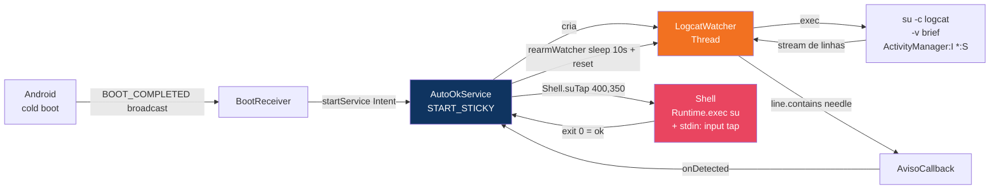
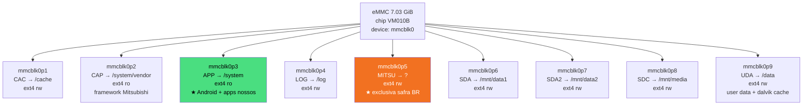

# Fluxo EvilValet (Mermaid)

Diagrama renderizável no GitHub via Mermaid. Mostra o fluxo completo do deploy via EvilValet
na nossa safra `1.F187.16` BR.

```mermaid
flowchart TD
    Start([Carro ligado + pendrive USB-A frontal plugado]) --> Audio[Segurar botão AUDIO por 5s]
    Audio --> Dialog{Diálogo<br/>"Quer reiniciar?"<br/>aparece?}
    Dialog -->|Sim| Confirm[Confirmar reiniciar]
    Dialog -->|Não| TryAgain[Tentar de novo:<br/>desligar carro,<br/>aguardar 15 min,<br/>religar]
    TryAgain --> Audio

    Confirm --> ColdBoot[Cold boot da central]
    ColdBoot --> SysUpdate[SystemUpdate.apk detecta<br/>SwUpdate2.txt no pendrive]
    SysUpdate --> SysUI["Tela mostra<br/>'Software update'<br/>'Current: 1.F187.16'<br/>'New: IC1101'<br/>'Copying...'"]
    SysUI --> SysCopy[SystemUpdate copia pacote<br/>para /data interno]
    SysCopy --> Reboot1[Reboot automático]

    Reboot1 --> Daup[daupdater roda no boot<br/>via libsurfaceflinger]
    Daup --> ReadRom[Lê custom_rom.type do<br/>/system/vendor/build.prop<br/>= 0040]
    ReadRom --> FindMdt[Procura<br/>/mnt/usbdrive1/0040/SwUpdate.mdt]
    FindMdt --> Verify[Valida assinatura<br/>contra testkey AOSP em<br/>res/keys do recovery]
    Verify -->|Testkey confere ✓| Stage[Estaga /cache/recovery/command]
    Stage --> Reboot2[Reboot para recovery]

    Reboot2 --> Recovery[Recovery executa<br/>META-INF/.../update-binary]
    Recovery --> UpdaterScript[Updater-script edify]

    UpdaterScript --> ExtractBB[Extrai busybox<br/>para /tmp/busybox]
    ExtractBB --> Mount[Mount APP → /system via edify<br/>via block device by-name]
    Mount --> InstallAPK[Extrai AutoOk.apk<br/>para /system/app/<br/>uid=0 gid=0 mode=0644]
    InstallAPK --> InstallSu[Extrai su para<br/>/system/xbin/su<br/>uid=0 gid=0 mode=06755<br/>SETUID]
    InstallSu --> Umount[Unmount /system + sync]
    Umount --> Sleep[Sleep 30s<br/>para janela de retirada]

    Sleep --> Reboot3[Reboot normal]
    Reboot3 --> Dexopt[Android faz dexopt<br/>do AutoOk.apk]
    Dexopt --> BootCompl[BOOT_COMPLETED broadcast]
    BootCompl --> BR[BootReceiver dispara<br/>AutoOkService]
    BR --> Watcher["AutoOk: watcher iniciado,<br/>aguardando<br/>com.mitsubishielectric.ada.app.dalauncher/<br/>.OpeningDivideActivity"]

    Watcher --> AvisoShow[Mitsubishi Launcher mostra<br/>DisclaimerFragment<br/>na OpeningDivideActivity]
    AvisoShow --> LogCat[Logcat emite:<br/>ActivityManager: START ...<br/>cmp=....OpeningDivideActivity]
    LogCat --> Detect[Watcher detecta match<br/>no logcat via substring]
    Detect --> Wait2[Aguarda 2 segundos]
    Wait2 --> Tap["Shell.suTap(400, 350):<br/>su -c input tap 400 350"]
    Tap --> Done[Aviso some automaticamente]

    Done --> Rearm[rearmWatcher():<br/>sleep 10s + handled=false +<br/>reinicia LogcatWatcher]
    Rearm --> Watcher

    style Verify fill:#e94560,color:#fff
    style InstallAPK fill:#4ade80,color:#000
    style InstallSu fill:#4ade80,color:#000
    style Done fill:#4ade80,color:#000
```

## Diagrama de arquitetura do APK



## Diagrama de partições eMMC da safra `1.F187.16` BR



A partição `APP` (= mmcblk0p3) é onde instalamos `AutoOk.apk` + `su`. É montada `ro` no boot
normal; o updater-script no recovery monta `rw` para gravar.

A partição `MITSU` (= mmcblk0p5) é exclusiva da safra BR — não existe na safra 2021 US
documentada no `ic1101`. Função exata ainda não determinada.
